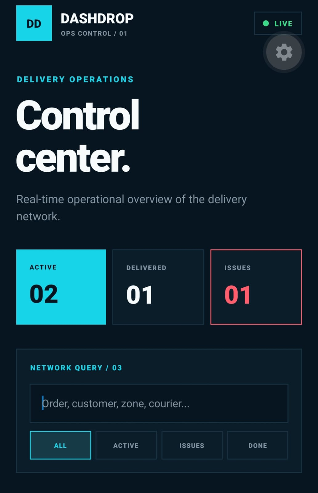
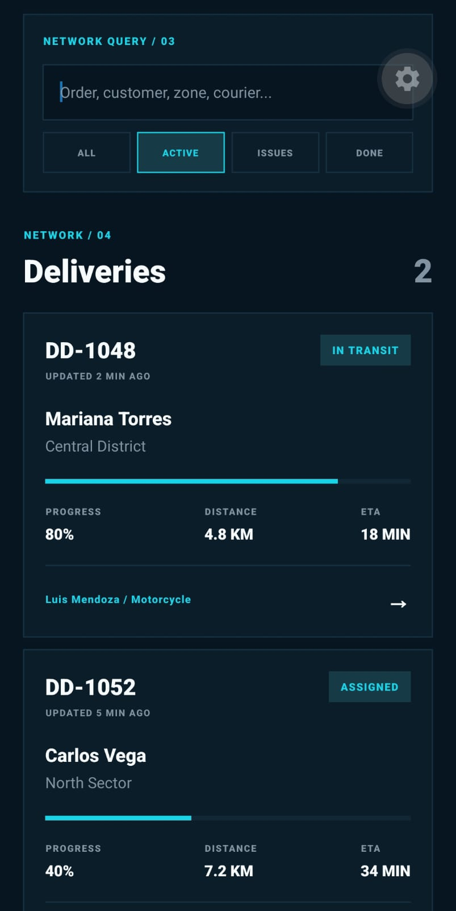
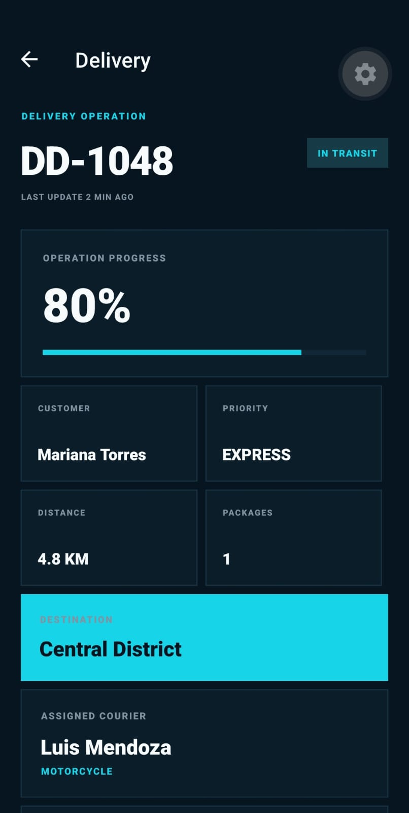
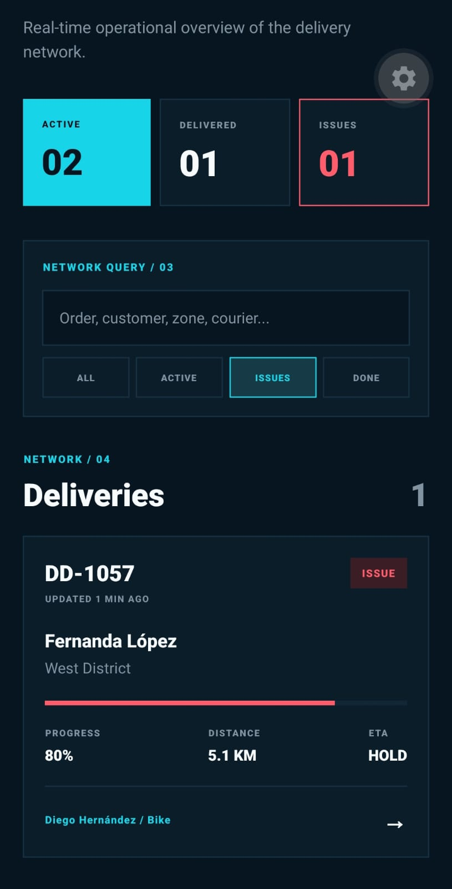

# 🚚 DashDrop

DashDrop is a React Native delivery operations control center built to practice mobile architecture, asynchronous data flows, mutations, filtering and operational state management.

The project is part of a hands-on React Native learning lab.

## ✨ Features

- Delivery operations dashboard
- Dynamic delivery detail screens
- Delivery status timeline
- Courier information
- Global network metrics
- Search and operational filters
- Pull-to-refresh
- Loading and error states
- Retry flows
- Simulated asynchronous service layer
- Delivery status mutations
- Incident resolution
- Optimistic priority updates
- Automatic rollback when a mutation fails
- Protection against stale async responses
- Dashboard synchronization after navigation

## 🏗️ Architecture

DashDrop separates UI, domain logic and data access.

    Screen
      ↓
    Feature hook
      ↓
    Service
      ↓
    Data source

The UI does not access mock data directly.

The current service uses an in-memory data store to simulate a backend, making it possible to replace the mock implementation with a real API later without rewriting the screens.

## 📦 Project Structure

    src/
    ├── app/
    │   ├── _layout.tsx
    │   ├── index.tsx
    │   └── deliveries/
    │       └── [id].tsx
    │
    ├── components/
    │   ├── DeliveryCard.tsx
    │   ├── DeliveryFilters.tsx
    │   └── PriorityControl.tsx
    │
    ├── features/
    │   └── deliveries/
    │       ├── deliveryHelpers.ts
    │       ├── mockDeliveries.ts
    │       ├── useDeliveries.ts
    │       └── useDelivery.ts
    │
    ├── hooks/
    │   └── useDebouncedValue.ts
    │
    ├── services/
    │   └── deliveryService.ts
    │
    ├── theme/
    │   └── colors.ts
    │
    └── types/
        └── delivery.ts

## 🔄 Async Data Flow

DashDrop simulates network latency and asynchronous operations.

The application handles:

- Initial loading
- Background refresh
- Query loading
- Mutation loading
- Service errors
- Retry flows
- Race-condition protection

Each async concern has its own state instead of relying on a single global loading flag.

## ⚡ Optimistic UI

Priority changes use an optimistic update strategy.

    user action
    ↓
    UI updates immediately
    ↓
    service request
    ↓
    success → keep new value
    failure → rollback

This provides faster perceived interaction while preserving data consistency.

## 🔎 Search and Filters

The dashboard supports:

- All deliveries
- Active deliveries
- Issues
- Delivered operations
- Search by order
- Customer
- Destination
- Courier
- Vehicle

Search uses a reusable debounce hook before sending the query to the service layer.

## 📊 Global Metrics

Operational metrics are calculated independently from the filtered delivery list.

This means search and filters affect the visible results without changing the global network summary.

Metrics include:

- Active operations
- Delivered operations
- Delivery issues
- Total operations

## 📱 Screenshots

### Operations Dashboard

  

### Search and Filters

  

### Delivery Detail

  

### Incident Control

  

## 🎨 Visual Direction

DashDrop uses a logistics control-center visual language.

The interface combines:

- Dark navy surfaces
- Electric cyan accents
- Operational amber
- Green success states
- Red incident states
- Compact technical labels
- High-contrast operational metrics

## 🛠️ Tech Stack

- React Native
- Expo SDK 57
- Expo Router
- React
- TypeScript
- react-native-safe-area-context

## 📚 What I Practiced

- Expo Router
- Dynamic routes
- Mobile navigation lifecycle
- TypeScript domain modeling
- Feature-based architecture
- Service abstraction
- Custom hooks
- Async loading and errors
- Retry strategies
- Pull-to-refresh
- Mutations
- Optimistic UI
- Rollback strategies
- Debouncing
- Search queries
- Operational filters
- Race-condition protection
- Derived global metrics
- Synchronization between screens

## ⚠️ Current Limitations

DashDrop is a learning project and not a production logistics platform.

- Data is simulated locally.
- There is no real backend.
- Mutations are stored only in memory.
- Data resets when the JavaScript runtime restarts.
- Authentication is not implemented.
- Live GPS tracking is not included.

## 🚀 Run Locally

Requirements:

    Node.js 22.19.0
    npm
    Expo Go

Install dependencies:

    npm install

Start Expo:

    npx expo start

Open the project using Expo Go on Android.

## 👨‍💻 Author

Víctor Hugo Segundo Aguilar

Frontend Developer focused on React, Angular, JavaScript and TypeScript, expanding into React Native and mobile application architecture.
